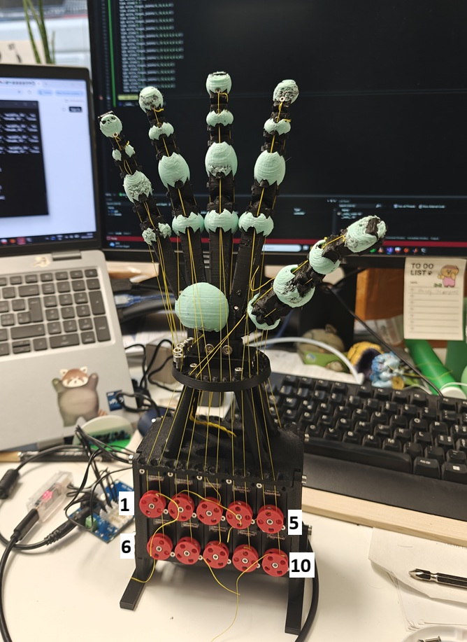
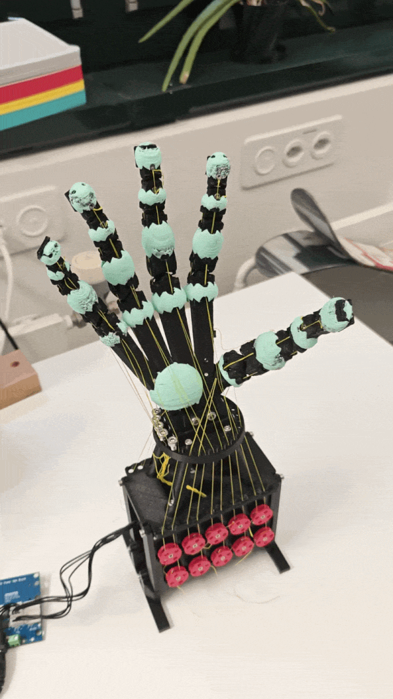

# oph_full_act
OPH with lots of dynamixels.

Figure 1: OPH assembly. Dynamixel IDs follow left-to-right, then top-to-bottom, then front-to-back IDs: 1--20.

Minimum working example in oph_full_act.py

Figure 2: OPH demo. Starting at stored home position, cycling through stored frames, then waving with joint control.

## notes
Startup can be dangerous with high current and dynamixels loosing initial positions (they don't know if they have rotated a full 360 degrees after rebooting). Keep default current low (50 mA) and only turn on when the hand is close to the 'home' position or in safe mode (admittance).

Kinematics are based-on default hand parameters from OpenSCAD design files. Other design files should be possible to load but it hasn't been tested for robustness.

Only 4 fingers are connected (5 motor per finger and total 20 motors), changing which fingers are connected or driving all 5 in a reduced mode (e.g. coupling abductor/adductor tendons) is not currently robust but can be added.
